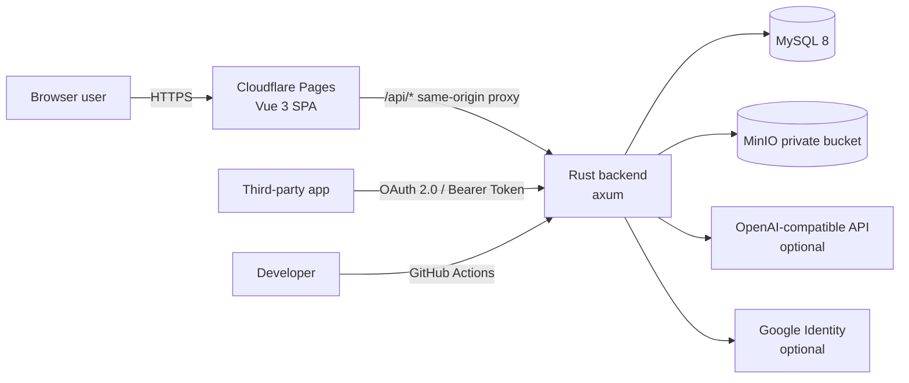

# System Architecture
[English](ARCHITECTURE.md) · [简体中文](ARCHITECTURE.zh-CN.md)

This document describes the overall architecture, request path, and key design decisions of the OpenForum production implementation (`backend-rs/` + `frontend/`). All conclusions are based on the code in the current repository.

## 1. System Context



- **Frontend**: A pure static SPA deployed on Cloudflare Pages; `public/_worker.js` forwards same-origin `/api/*` to the backend, avoiding cross-origin issues and extra CORS configuration.
- **Backend**: A single axum service, stateless (except plugin switches), and horizontally scalable.
- **Database**: MySQL 8, the only persistent source of business data.
- **Object storage**: A MinIO private bucket for post media and verification materials.
- **External services**: AI moderation (OpenAI-compatible API) and Google sign-in are optional; the corresponding features degrade gracefully when not configured.

## 2. Runtime Topology

| Component | Location | Notes |
| --- | --- | --- |
| SPA | Cloudflare Pages | Build output `frontend/dist`; the Worker handles API proxying and SPA fallback |
| Reverse proxy | Cloudflare Worker / Nginx | Forwards `/api` to the backend `:8091` (`:8080` inside the container) |
| Backend container | `openforum-rs` | Built and deployed by `deploy-rs.yml` |
| MySQL | Dedicated container / managed instance | Shares the same database with the legacy Java version |
| MinIO | Dedicated container / managed instance | The bucket is private, path-style access |

The backend container defaults to the resource limits `--memory 256m --memory-swap 384m`. The release profile enables `lto=thin`, `strip`, and `panic=abort` to reduce image size and memory footprint.

## 3. Backend Modules

```text
src/
├── main.rs          Startup, config validation, route mounting, middleware, security gate
├── config.rs        Environment variable parsing and startup validation
├── db.rs            MySQL connection pool
├── state.rs         Shared state AppState
├── routes/          HTTP handlers split by business domain
├── dto.rs           Request / response structs
├── models.rs        Database row models
├── repo.rs          Queries and persistence
├── security.rs      JWT signing/parsing, password hashing, CurrentUser extractor
├── error.rs         Unified errors and response envelope
├── json.rs          JSON utilities
├── enums.rs         Enums such as auth levels
├── access.rs        Forum owner / moderator permissions
├── gate.rs          Access rule model and evaluation
├── auth_gate.rs     Rule evaluation (combines user profile and verification status)
├── info.rs          User profile field catalog
├── review.rs        Review pipeline (rules / AI / manual)
├── plugins.rs       Plugin registry
├── storage.rs       MinIO wrapper
├── oauth.rs         OAuth primitives
├── vote.rs          Voting and score calculation
├── sanitizer.rs     HTML sanitization
├── seeder.rs        Seed data
└── migrate.rs       Idempotent table creation and column migration
```

Handlers under `routes/` only parse parameters, check permissions, and assemble responses. Logic shared across modules is pushed down into `repo`, `gate`, `oauth`, `storage`, and other modules to avoid circular dependencies.

## 4. Request Lifecycle

```mermaid
sequenceDiagram
    participant C as Client
    participant T as TraceLayer
    participant O as CorsLayer
    participant G as spring_security_gate
    participant B as BodyLimit(60MB)
    participant R as Router / Handler
    participant D as MySQL / MinIO

    C->>T: HTTP request
    T->>O: Pass through + record
    O->>G: Preflight returns immediately / continue
    G->>G: OPTIONS pass; GET /media/** pass
    G->>G: Parse Bearer JWT
    alt /admin/**
        G-->>C: Not logged in 401 / not admin 403
    else Public paths
        G->>B: Allow
    else Other paths
        G->>B: Allow if logged in, otherwise 401
    end
    B->>R: Route match
    R->>D: sqlx / S3
    D-->>R: Data
    R-->>C: {code,message,data}
```

### 4.1 Security Gate

`spring_security_gate` replicates the path-level authorization semantics of the legacy Java `SecurityConfig`:

- `OPTIONS` requests pass through directly (CORS preflight).
- `GET /media/**` is readable anonymously (post image / video proxy).
- `/admin/**` requires the `ADMIN` role.
- Public paths reachable anonymously:
  - `/auth/**`, `/forums/**`, `/posts/**`, `/comments/**`, `/users/**`
  - `/plugins` (the list endpoint only)
  - `/authentications/types`
  - `/oauth/**`
  - `/developers/docs`
- All other paths require login.

Unauthenticated requests return `401 {"code":401,"message":"unauthorized"}`; authenticated but unauthorized requests return `403 {"code":403,"message":"forbidden"}`. Both responses are written directly by the filter layer and **do not include a `data` field**.

Handlers also perform a second authorization pass, for example:

- `/developers/apps/**` only allows operations on apps created by the caller.
- `/plugins/:key/enabled` requires an administrator.
- `/authentications/media/:id` is readable only by the owner or an administrator.
- Forum browse / operate rules are evaluated per request inside the `forums`, `posts`, and `comments` handlers.

### 4.2 Request Body Limit

The global limit is `DefaultBodyLimit::max(60MB)`, aligned with the legacy Java `spring.servlet.multipart.max-request-size`. Per-type limits for images and videos (10MB / 50MB) are enforced in handlers.

## 5. Authentication Model

- **Algorithm**: JWT HS256; `sub` is the user ID; claims include `username` and `role`.
- **Validity**: 168 hours by default (`JWT_EXPIRATION_HOURS`).
- **Startup validation**: Startup is refused when `JWT_SECRET` is shorter than 32 bytes; a warning is printed when the built-in default secret is detected.
- **Passwords**: Stored as bcrypt hashes.
- **OAuth access tokens**: Use the same JWT as first-party login, with additional `cid` (client ID), `scope`, and `typ` claims. They are therefore accepted by the existing access gate and the `CurrentUser` extractor, and inherit the authorizing user's permissions.
- **Refresh tokens / authorization codes**: Random 256-bit values; only SHA-256 hashes are stored in the database, and the plaintext is returned only once at issuance.

The `CurrentUser` extractor parses the token from the `Authorization` header. Handlers use `require()` / `require_admin()` to declare whether login or administrator status is required.

## 6. Data Access and Migration

- A `sqlx` connection pool is used; connection parameters are parsed from `DB_URL` (compatible with the `jdbc:mysql://` prefix); the charset is fixed to `utf8mb4`.
- Queries are mostly explicit SQL; row structs are mapped via `sqlx::FromRow`.
- `migrate.rs` runs a set of `CREATE TABLE IF NOT EXISTS` statements at startup, covering newer tables such as user profiles, homepages, and OAuth; failures are logged as warnings only and do not block startup.
- `seeder.rs` injects demo data and default accounts only when `sub_forums` is empty; the transaction commits to avoid a half-initialized state.
- See [`backend-rs/sql/schema.sql`](../backend-rs/sql/schema.sql) and [DATABASE.md](DATABASE.md) for the full baseline schema.

> There are no database foreign key constraints between tables (the structure inherited from legacy JPA); referential integrity is enforced by the application layer.

## 7. Object Storage

`Storage` has two states:

- `Disabled`: `MINIO_ENABLED=false`; all upload / read requests return 400.
- `Minio`: Connects to a custom endpoint via `rust-s3`, uses `with_path_style()` for MinIO compatibility, and fixes the region to `us-east-1`.

The bucket is private, so reads always go through backend proxy endpoints rather than direct presigned URLs:

- `GET /api/media/:id`: post media, readable anonymously.
- `GET /api/authentications/media/:id`: verification materials, readable only by the owner or an administrator.

Upload paths are sharded by date, and filenames use random values to prevent overwrites and enumeration.

## 8. Access Gate Engine

Forums can be configured with two kinds of rules:

| Rule | Field | Effect |
| --- | --- | --- |
| Browse rule | `sub_forums.browse_rule` / `access_rules` | Whether the forum and posts can be viewed |
| Operate rule | `sub_forums.operate_rule` / `access_rules` | Whether the user can post, comment, and vote |

Rule structure (`gate.rs`):

```json
{
  "version": 1,
  "conditions": [
    { "field": "AUTH_LEVEL", "op": "GTE", "authLevel": "MEDIUM" },
    { "field": "AGE", "op": "BETWEEN", "min": 18, "max": 60 },
    { "field": "COUNTRY", "op": "IN", "values": ["CN", "SG"] }
  ]
}
```

- An empty condition list means no access gate.
- `auth_gate.rs` compares each condition against the user's verification records and profile fields, then returns a `GateVerdict`.
- On failure it returns `403`, with structured `gate`, `forumId`, and `missing` lists in `data`; the frontend uses these to show "which verifications / profile fields are missing".
- The legacy field `required_auth_types` remains as a compatibility fallback.

## 9. Verification Center

- **Verification types**: `REAL_NAME`, `ID_CARD`, `AGE`, `NATIONALITY`, `DRIVER_LICENSE`, `MARRIAGE_CERT`, `PROPERTY_CERT`, `ASSETS`, plus the profile-system types `CITY`, `EDUCATION`, `GENDER`, `INTERESTS`, `OCCUPATION`, `CUSTOM`.
- **Levels**: `LOW=1`, `MEDIUM=2`, `HIGH=3`, `EXTREME=4`.
- **Flow**: create challenge (`/authentications/challenge`) → upload materials → submit verification → rule / AI review → manual review → result written to `user_authentications`.
- **Review records**: `auth_review_logs` stores the action, method, confidence, and reason.
- **Auto-approval**: When confidence reaches `AUTH_AUTO_APPROVE_THRESHOLD` (default 0.85), rules / AI may approve automatically.
- **Liveness detection**: Performed client-side in the browser with MediaPipe; the video is uploaded as material only.

## 10. Plugin System

The plugin registry is maintained in-process and provides 5 built-in plugins:

| Key | Type | Default | Effect |
| --- | --- | --- | --- |
| `ai-review` | REVIEW | Off | Calls AI to review text content |
| `ai-vision-review` | DOCUMENT_REVIEW | Off | AI review of images / identity documents |
| `heuristic-document` | DOCUMENT_REVIEW | On | Rule-based identity document checks |
| `hot-score-recommendation` | RECOMMENDATION | On | Hot-score ranked recommendations |
| `rule-based-review` | REVIEW | On | Keyword / rule review |

- `GET /api/plugins` publicly returns plugin metadata and current switches.
- `PUT /api/plugins/:key/enabled` is available to administrators only.

**Limitation**: Switches are kept in memory only and revert to defaults after a process restart. This is a known trade-off of the current implementation; persistence would require a new configuration table.

## 11. Custom Homepage Security Model

User homepages and forum homepages let authors write HTML. The security boundary consists of three layers:

1. **Server-side sanitization**: `sanitizer.rs` uses the ammonia allowlist to filter tags, attributes, and URL schemes.
2. **Sandboxed rendering**: The frontend `SafeHomepageFrame.vue` uses `<iframe sandbox="allow-scripts" srcdoc>`. Scripts can run, but `allow-same-origin` is not granted, so they cannot read the parent page, cookies, or site storage.
3. **Governance**: A report endpoint plus admin console blocking (`status=BLOCKED`, `block_reason`, `blocked_by`); once blocked, public endpoints no longer return the content.

Homepage content is stored in `user_homepages` / `forum_homepages`, with the size limit recorded in `size_bytes`.

## 12. Frontend Architecture

```text
src/
├── api/          Axios instance and API wrappers
├── components/   Shared components (navigation, editor, votes, comment tree, homepage sandbox, etc.)
├── data/         API reference page data
├── directives/   Interactive directives such as reveal
├── router/       Routes and login guard
├── stores/       Pinia: auth, ui
├── styles/       Global styles and design tokens
├── types/        TypeScript types
├── utils/        Formatting, gate hints, homepage templates
└── views/        Page-level components
```

Key conventions:

- **API base URL**: `import.meta.env.VITE_API_BASE_URL || '/forum/api'`.
- **Login state**: `localStorage.token`; the router guard intercepts `requiresAuth` routes before navigation.
- **Build path**: `VITE_BASE_PATH` defaults to `/forum/`; set it to `/` when deploying on a dedicated domain.
- **Editor**: Tiptap, with extensions for tables, images, videos, and superscript, plus Markdown import/export.
- **On-demand loading**: Element Plus is auto-imported via `unplugin-vue-components`.

Page routes cover: home, login/register, search, create forum, verification wizard, personal homepage and settings, forum homepage and settings, moderator panel, post detail, admin console, developer center, and OAuth authorization page.

## 13. Key Design Decisions

| Decision | Rationale | Cost |
| --- | --- | --- |
| Rust + axum replacing the Java backend | Lower runtime memory and faster cold start; runs in a single 256MB container | SQL and migrations must be maintained by hand |
| Keeping the response envelope | Fully compatible with the legacy frontend and API semantics | OAuth standard endpoints must bypass the envelope |
| OAuth tokens reusing first-party JWTs | Third-party apps automatically gain full API capabilities without a second auth stack | Token revocation can only target refresh tokens |
| No Redis | No hard caching / session requirements, one less failure point | Plugin switches, rate limiting, etc. can only be implemented in-process |
| No database foreign keys | Keeps the historical structure and lets both backends share the schema | Consistency must be enforced by the application layer |
| Cloudflare Worker same-origin proxy | No CORS, hides the backend address, simple deployment | Backend address changes require updating Pages environment variables |

## 14. Known Limitations

- Plugin switches are not persisted; in multi-instance deployments, instance states diverge.
- There is no endpoint-level rate limiting; for high-traffic scenarios, add rate limiting at the reverse proxy layer.
- The legacy `backend/` code is no longer developed and serves as reference only.
- Schema changes currently rely on manually maintained `schema.sql` and `migrate.rs`; there is no versioned migration tool.
