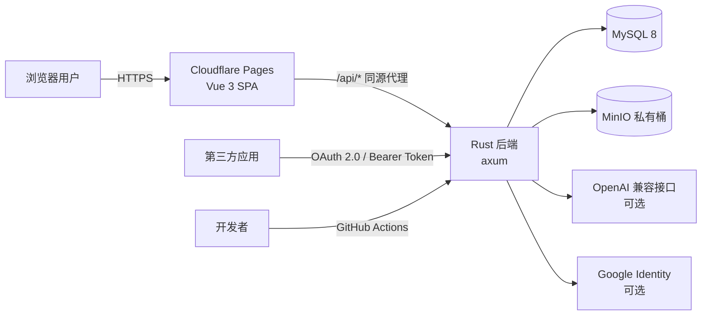
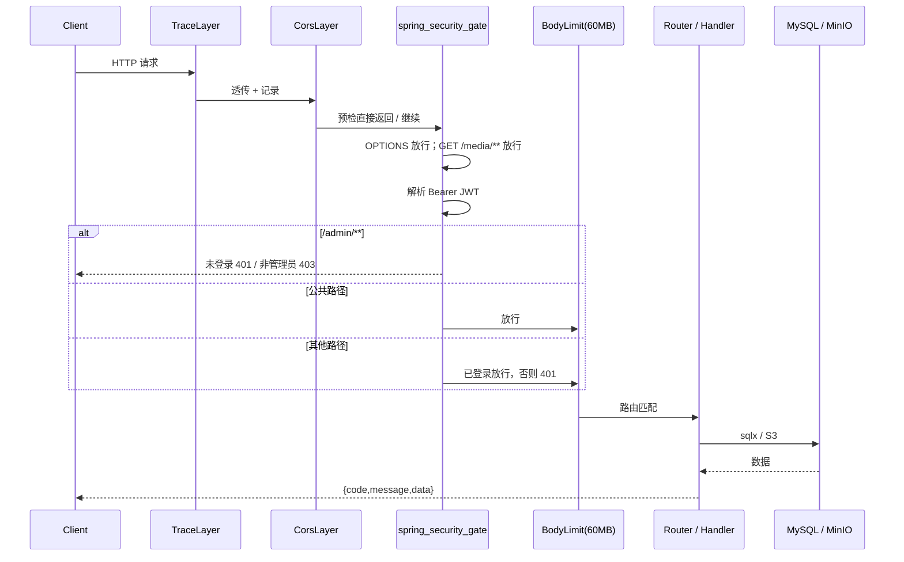

# 系统架构
[English](ARCHITECTURE.md) · **简体中文**

本文描述 OpenForum 线上实现（`backend-rs/` + `frontend/`）的整体架构、请求链路与关键设计决策。所有结论均以当前仓库代码为准。

## 1. 系统上下文



- **前端**：纯静态 SPA，部署在 Cloudflare Pages；`public/_worker.js` 把同源 `/api/*` 转发到后端，避免跨域与额外 CORS 配置。
- **后端**：单个 axum 服务，无状态（除插件开关外），可水平扩展。
- **数据库**：MySQL 8，唯一持久化业务数据源。
- **对象存储**：MinIO 私有桶，用于帖子媒体与认证材料。
- **外部服务**：AI 审核（OpenAI 兼容 API）与 Google 登录均为可选，未配置时对应功能自动降级。

## 2. 运行时拓扑

| 组件 | 位置 | 说明 |
| --- | --- | --- |
| SPA | Cloudflare Pages | 构建产物 `frontend/dist`，Worker 负责 API 代理与 SPA 回退 |
| 反向代理 | Cloudflare Worker / Nginx | 将 `/api` 转发到后端 `:8091`（容器内 `:8080`） |
| 后端容器 | `openforum-rs` | 由 `deploy-rs.yml` 构建并部署 |
| MySQL | 独立容器 / 托管实例 | 与旧 Java 版共用同一库 |
| MinIO | 独立容器 / 托管实例 | 桶为私有，路径风格访问 |

后端容器默认资源限制为 `--memory 256m --memory-swap 384m`，发布配置启用 `lto=thin`、`strip`、`panic=abort`，以缩小镜像与内存占用。

## 3. 后端模块划分

```text
src/
├── main.rs          启动、配置校验、路由挂载、中间件、安全门禁
├── config.rs        环境变量解析与启动校验
├── db.rs            MySQL 连接池
├── state.rs         共享状态 AppState
├── routes/          按业务域拆分的 HTTP 处理器
├── dto.rs           请求 / 响应结构
├── models.rs        数据库行模型
├── repo.rs          查询与持久化
├── security.rs      JWT 签发/解析、密码哈希、CurrentUser 提取器
├── error.rs         统一错误与响应信封
├── json.rs          JSON 工具
├── enums.rs         认证等级等枚举
├── access.rs        坛主 / 版主权限
├── gate.rs          访问规则模型与判定
├── auth_gate.rs     规则求值（结合用户资料与认证状态）
├── info.rs          用户资料字段目录
├── review.rs        审核流程（规则 / AI / 人工）
├── plugins.rs       插件注册表
├── storage.rs       MinIO 封装
├── oauth.rs         OAuth 基础能力
├── vote.rs          投票与分数计算
├── sanitizer.rs     HTML 净化
├── seeder.rs        种子数据
└── migrate.rs       幂等建表与字段迁移
```

`routes/` 内的处理器只做参数解析、权限判断与响应组装；跨模块共享逻辑下沉到 `repo`、`gate`、`oauth`、`storage` 等模块，避免循环依赖。

## 4. 请求生命周期



### 4.1 安全门禁

`spring_security_gate` 复刻旧 Java `SecurityConfig` 的路径级授权语义：

- `OPTIONS` 请求直接放行（CORS 预检）。
- `GET /media/**` 匿名可读（帖子图片 / 视频代理）。
- `/admin/**` 需要 `ADMIN` 角色。
- 公共路径匿名可达：
  - `/auth/**`、`/forums/**`、`/posts/**`、`/comments/**`、`/users/**`
  - `/plugins`（仅列表本身）
  - `/authentications/types`
  - `/oauth/**`
  - `/developers/docs`
- 其余路径一律要求已登录。

未认证返回 `401 {"code":401,"message":"unauthorized"}`，已认证但无权限返回 `403 {"code":403,"message":"forbidden"}`；这两个响应由过滤器层直接写出，**不含 `data` 字段**。

处理器内部还会做二次授权，例如：

- `/developers/apps/**` 只允许操作自己创建的应用。
- `/plugins/:key/enabled` 需要管理员。
- `/authentications/media/:id` 仅本人或管理员可读。
- 论坛的浏览 / 操作规则在 `forums`、`posts`、`comments` 处理器内逐次判定。

### 4.2 请求体限制

全局 `DefaultBodyLimit::max(60MB)`，与旧 Java 的 `spring.servlet.multipart.max-request-size` 对齐；图片与视频的细分上限（10MB / 50MB）在处理器中校验。

## 5. 鉴权模型

- **算法**：JWT HS256，`sub` 为用户 ID，claims 含 `username`、`role`。
- **有效期**：默认 168 小时（`JWT_EXPIRATION_HOURS`）。
- **启动校验**：`JWT_SECRET` 少于 32 字节时拒绝启动；检测到内置默认密钥会打印告警。
- **密码**：bcrypt 哈希存储。
- **OAuth 访问令牌**：与第一方登录使用同一套 JWT，仅额外携带 `cid`（客户端 ID）、`scope`、`typ`，因此天然被现有门禁与 `CurrentUser` 提取器接受，并继承授权用户的权限。
- **刷新令牌 / 授权码**：随机 256 位值，数据库中只保存 SHA-256 哈希，明文仅在签发时返回一次。

`CurrentUser` 提取器从 `Authorization` 头解析令牌；处理器通过 `require()` / `require_admin()` 表达是否需要登录或管理员身份。

## 6. 数据访问与迁移

- 使用 `sqlx` 连接池，连接参数由 `DB_URL` 解析（兼容 `jdbc:mysql://` 前缀），字符集固定 `utf8mb4`。
- 查询以显式 SQL 为主，行结构通过 `sqlx::FromRow` 映射。
- `migrate.rs` 在启动时执行一组 `CREATE TABLE IF NOT EXISTS`，覆盖用户资料、主页、OAuth 等较新的表；失败只记录告警，不阻塞启动。
- `seeder.rs` 仅在 `sub_forums` 为空时注入演示数据与默认账号，事务提交，避免半初始化状态。
- 完整基线结构见 [`backend-rs/sql/schema.sql`](../backend-rs/sql/schema.sql) 与 [DATABASE.md](DATABASE.zh-CN.md)。

> 表之间没有数据库外键约束（沿用旧 JPA 生成的结构），引用完整性由应用层保证。

## 7. 对象存储

`Storage` 有两种状态：

- `Disabled`：`MINIO_ENABLED=false`，所有上传 / 读取请求返回 400。
- `Minio`：使用 `rust-s3` 连接自定义 endpoint，`with_path_style()` 适配 MinIO，区域固定 `us-east-1`。

桶为私有，读取统一走后端代理接口，而不是直出预签名 URL：

- `GET /api/media/:id`：帖子媒体，匿名可读。
- `GET /api/authentications/media/:id`：认证材料，仅本人或管理员可读。

上传路径按日期分片，文件名使用随机值，避免覆盖与枚举。

## 8. 访问门禁引擎

论坛可配置两类规则：

| 规则 | 字段 | 作用 |
| --- | --- | --- |
| 浏览规则 | `sub_forums.browse_rule` / `access_rules` | 能否查看论坛与帖子 |
| 操作规则 | `sub_forums.operate_rule` / `access_rules` | 能否发帖、评论、投票 |

规则结构（`gate.rs`）：

```json
{
  "version": 1,
  "conditions": [
    { "field": "AUTH_LEVEL", "op": "GTE", "authLevel": "MEDIUM" },
    { "field": "AGE", "op": "BETWEEN", "min": 18, "max": 60 },
    { "field": "COUNTRY", "op": "IN", "values": ["CN", "SG"] }
  ]
}
```

- 条件列表为空表示不设门禁。
- `auth_gate.rs` 将条件与用户的认证记录、资料字段逐项比对，返回 `GateVerdict`。
- 未通过时返回 `403`，`data` 中带有结构化的 `gate`、`forumId`、`missing` 列表，前端据此展示「缺少哪些认证 / 资料」。
- 旧字段 `required_auth_types` 仍作为兼容回退。

## 9. 认证中心

- **认证类型**：`REAL_NAME`、`ID_CARD`、`AGE`、`NATIONALITY`、`DRIVER_LICENSE`、`MARRIAGE_CERT`、`PROPERTY_CERT`、`ASSETS`，以及资料体系中的 `CITY`、`EDUCATION`、`GENDER`、`INTERESTS`、`OCCUPATION`、`CUSTOM`。
- **等级**：`LOW=1`、`MEDIUM=2`、`HIGH=3`、`EXTREME=4`。
- **流程**：创建挑战（`/authentications/challenge`）→ 上传材料 → 提交认证 → 规则 / AI 审核 → 人工复核 → 结果写入 `user_authentications`。
- **审核记录**：`auth_review_logs` 保存动作、方法、置信度与原因。
- **自动通过**：置信度达到 `AUTH_AUTO_APPROVE_THRESHOLD`（默认 0.85）时可由规则 / AI 自动通过。
- **活体检测**：前端使用 MediaPipe 在浏览器侧完成，视频仅作为材料上传。

## 10. 插件系统

插件注册表在进程内维护，提供 5 个内置插件：

| Key | 类型 | 默认 | 作用 |
| --- | --- | --- | --- |
| `ai-review` | REVIEW | 关 | 调用 AI 审核文本内容 |
| `ai-vision-review` | DOCUMENT_REVIEW | 关 | AI 审核图片 / 证件材料 |
| `heuristic-document` | DOCUMENT_REVIEW | 开 | 基于规则的证件材料检查 |
| `hot-score-recommendation` | RECOMMENDATION | 开 | 热度排序推荐 |
| `rule-based-review` | REVIEW | 开 | 关键词 / 规则审核 |

- `GET /api/plugins` 公开返回插件元数据与当前开关。
- `PUT /api/plugins/:key/enabled` 仅管理员可用。

**限制**：开关只保存在内存中，进程重启后恢复默认值。这是当前实现的已知取舍，若需要持久化应新增配置表。

## 11. 自定义主页安全模型

用户主页与论坛主页允许作者编写 HTML，安全边界由三层构成：

1. **服务端净化**：`sanitizer.rs` 使用 ammonia 白名单过滤标签、属性与 URL 协议。
2. **沙箱渲染**：前端 `SafeHomepageFrame.vue` 使用 `<iframe sandbox="allow-scripts" srcdoc>`。脚本可以运行，但未授予 `allow-same-origin`，因此无法读取父页面、Cookie 或站点存储。
3. **治理**：举报接口 + 管理后台屏蔽（`status=BLOCKED`、`block_reason`、`blocked_by`），屏蔽后公开接口不再返回内容。

主页内容存于 `user_homepages` / `forum_homepages`，大小上限记录在 `size_bytes`。

## 12. 前端架构

```text
src/
├── api/          Axios 实例与接口封装
├── components/   通用组件（导航、编辑器、投票、评论树、主页沙箱等）
├── data/         API 参考页数据
├── directives/   reveal 等交互指令
├── router/       路由与登录守卫
├── stores/       Pinia：auth、ui
├── styles/       全局样式与设计变量
├── types/        TypeScript 类型
├── utils/        格式化、门禁提示、主页模板
└── views/        页面级组件
```

关键约定：

- **API 基地址**：`import.meta.env.VITE_API_BASE_URL || '/forum/api'`。
- **登录态**：`localStorage.token`；路由守卫在 `requiresAuth` 路由上做前置拦截。
- **构建路径**：`VITE_BASE_PATH` 默认 `/forum/`，独立域名部署时设为 `/`。
- **编辑器**：Tiptap，扩展包含表格、图片、视频、上标，支持 Markdown 导入导出。
- **按需加载**：Element Plus 通过 `unplugin-vue-components` 自动引入。

页面路由覆盖：首页、登录/注册、搜索、创建论坛、认证向导、个人主页与设置、论坛主页与设置、版主面板、帖子详情、管理后台、开发者中心、OAuth 授权页。

## 13. 关键设计决策

| 决策 | 原因 | 代价 |
| --- | --- | --- |
| Rust + axum 取代 Java 后端 | 更低的运行内存与更快的冷启动，单容器 256MB 可运行 | 需要自行维护 SQL 与迁移 |
| 保留统一响应信封 | 与旧前端、旧接口语义完全兼容 | OAuth 标准端点必须绕开信封 |
| OAuth 令牌复用第一方 JWT | 第三方应用自动获得全部接口能力，无需第二套鉴权 | 令牌撤销只能针对刷新令牌 |
| 无 Redis | 业务无强缓存 / 会话需求，减少一个故障点 | 插件开关、限流等只能进程内实现 |
| 未引入数据库外键 | 沿用历史结构，便于双后端共用 | 需应用层保证一致性 |
| Cloudflare Worker 同源代理 | 免 CORS、隐藏后端地址、部署简单 | 后端地址变更需更新 Pages 环境变量 |

## 14. 已知限制

- 插件开关不持久化，多实例部署时各实例状态不一致。
- 未实现接口级限流；高流量场景建议在反向代理层加限流。
- 旧 `backend/` 代码不再演进，仅作参考。
- 数据库结构变更目前依赖 `schema.sql` 与 `migrate.rs` 手工维护，没有版本化迁移工具。
