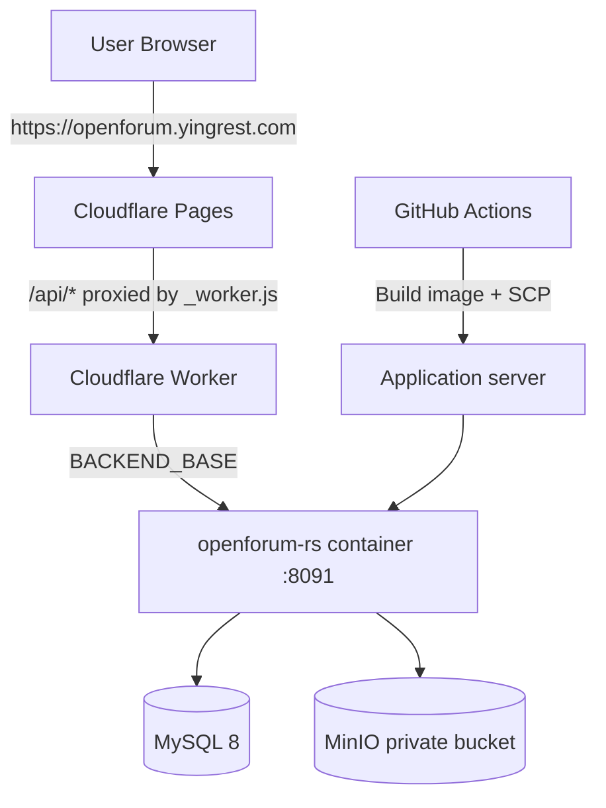

# Deployment Guide

[English](DEPLOYMENT.md) · [简体中文](DEPLOYMENT.zh-CN.md)

This document describes how OpenForum is deployed in production: the frontend is hosted on Cloudflare Pages, the backend runs as a Docker container, and the data layer uses MySQL 8 and MinIO.

## 1. Deployment Topology



| Component | Location | Port |
| --- | --- | --- |
| Frontend static assets | Cloudflare Pages project `openforum` | 443 |
| API proxy | `frontend/public/_worker.js` | — |
| Backend container | Application server Docker | `8091:8080` |
| MySQL | Container / managed instance | 3306 (internal network) |
| MinIO | Container / managed instance | 9000 (internal network) |

## 2. Prerequisites

1. A Cloudflare account and a Pages project with a domain bound to it.
2. A Linux server accessible via SSH, with Docker installed.
3. A MySQL 8.0 database (database name `openforum`, character set `utf8mb4`).
4. MinIO (or any S3-compatible service) with a private bucket, for example `openforum-auth`.
5. Repository secret: `SSH_PRIVATE_KEY`.

## 3. Frontend Deployment (Cloudflare Pages)

### 3.1 Build Parameters

| Item | Value |
| --- | --- |
| Root directory | `frontend` |
| Build command | `npm run build` |
| Output directory | `dist` |
| Node version | 18+ |

Build environment variables:

| Variable | Example | Description |
| --- | --- | --- |
| `VITE_BASE_PATH` | `/` | Use `/` for deployment on a dedicated domain; use `/forum/` for subpath deployment |
| `VITE_API_BASE_URL` | `/api` | Must match the proxy path in `_worker.js` |
| `VITE_APP_NAME` | `OpenForum` | Site title |
| `VITE_GOOGLE_CLIENT_ID` | `xxx.apps.googleusercontent.com` | Optional; leave empty to hide Google sign-in |

### 3.2 Runtime Variables

`BACKEND_BASE` in the Pages project settings is used by the Worker, for example:

```text
BACKEND_BASE=https://backend.example.com
```

`_worker.js` rewrites `/api/*`, `/forum/api/*`, and `/forum/rs/api/*` to `/api/*` before forwarding them to `BACKEND_BASE`, and also provides the `/__health` health check and SPA fallback.

### 3.3 Manual Release

```bash
cd frontend
npm ci
VITE_BASE_PATH=/ VITE_API_BASE_URL=/api VITE_APP_NAME=OpenForum npm run build
npx wrangler pages deploy dist --project-name openforum --branch main
```

After releasing, bind the custom domain in the Pages console and enable HTTPS.

## 4. Backend Deployment

### 4.1 Prepare the Environment Variable File

Create `/root/openforum-build-rs/openforum-rs.env` on the server, using [openforum-rs.env.example](../backend-rs/deploy/openforum-rs.env.example) as a reference:

```bash
SERVER_PORT=8080

DB_URL=jdbc:mysql://openforum-mysql:3306/openforum
DB_USER=openforum
DB_PASSWORD=<strong-password>

JWT_SECRET=<random-value-of-at-least-32-bytes>
JWT_EXPIRATION_HOURS=168

MINIO_ENABLED=true
MINIO_ENDPOINT=http://minio:9000
MINIO_ACCESS_KEY=<access-key>
MINIO_SECRET_KEY=<secret-key>
MINIO_BUCKET=openforum-auth

AI_ENABLED=false
GOOGLE_CLIENT_ID=
```

Notes:

- The environment file contains secrets; set its permissions to `600` and do not commit it to the repository.
- The hostname in `DB_URL` must be resolvable within the container network.
- `JWT_SECRET` and the database password must be replaced in production.

### 4.2 Manual Build and Start

```bash
docker build -t openforum-rs:latest backend-rs

docker network create openforum-net 2>/dev/null || true

docker stop openforum-rs 2>/dev/null || true
docker rm openforum-rs 2>/dev/null || true

docker run -d --name openforum-rs \
  --network openforum-net \
  --restart unless-stopped \
  -p 8091:8080 \
  --memory 256m --memory-swap 384m \
  --env-file /root/openforum-build-rs/openforum-rs.env \
  openforum-rs:latest
```

After the container starts, check it with:

```bash
docker ps --filter name=openforum-rs
docker logs --tail 50 openforum-rs
curl -s http://127.0.0.1:8091/api/plugins | head
```

### 4.3 Automated Deployment with GitHub Actions

[`deploy-rs.yml`](../.github/workflows/deploy-rs.yml) is triggered by:

- a push to `main` where the changes include `backend-rs/**` or the workflow file itself;
- a manual `workflow_dispatch`.

Flow: `docker build` → `docker save | gzip` → `scp` to the server → `docker load` → recreate the container → health wait and log output. On failure, the job prints the container logs and exits with a non-zero status.

Required configuration:

| Name | Type | Description |
| --- | --- | --- |
| `SSH_PRIVATE_KEY` | Repository secret | Deployment private key (PEM or base64 supported) |
| `production` | Environment | Optional, used to protect deployments |

The server address and port are defined in the workflow and must be updated when migrating servers.

## 5. Reverse Proxy

### 5.1 Cloudflare Worker (Current Production Approach)

`_worker.js` already handles:

- same-origin proxying to avoid CORS;
- forwarding request bodies (including multipart uploads);
- removing `content-encoding` / `content-length` to avoid inconsistent compression headers;
- returning `502 {"code":502,"message":"API upstream error"}` on upstream errors;
- falling back to `index.html` when a static asset is 404 and `Accept: text/html`.

### 5.2 Nginx (Alternative)

```nginx
server {
    listen 443 ssl;
    server_name forum.example.com;

    root /var/www/openforum;
    index index.html;

    location /api/ {
        proxy_pass http://127.0.0.1:8091/api/;
        proxy_set_header Host $host;
        proxy_set_header X-Real-IP $remote_addr;
        proxy_set_header X-Forwarded-For $proxy_add_x_forwarded_for;
        proxy_set_header X-Forwarded-Proto $scheme;
        client_max_body_size 60m;
    }

    location /assets/ {
        expires 30d;
        add_header Cache-Control "public, immutable";
    }

    location / {
        try_files $uri $uri/ /index.html;
    }
}
```

> The upload endpoint accepts up to 60MB, so Nginx's `client_max_body_size` must not be less than that value.

## 6. Database and Storage

### 6.1 Initialize the Database

```bash
mysql -h <host> -u root -p -e "CREATE DATABASE openforum CHARACTER SET utf8mb4 COLLATE utf8mb4_unicode_ci;"
mysql -h <host> -u root -p openforum < backend-rs/sql/schema.sql

# Prefer a dedicated account over root
mysql -h <host> -u root -p -e "
CREATE USER 'openforum'@'%' IDENTIFIED BY '<strong-password>';
GRANT SELECT, INSERT, UPDATE, DELETE, CREATE, ALTER, INDEX ON openforum.* TO 'openforum'@'%';
FLUSH PRIVILEGES;"
```

### 6.2 MinIO

```bash
mc alias set local http://127.0.0.1:9000 <access-key> <secret-key>
mc mb local/openforum-auth
mc anonymous set none local/openforum-auth   # Private bucket
```

Keep the bucket private; read access is always provided through the backend endpoints `/api/media/:id` and `/api/authentications/media/:id`.

## 7. Post-Release Verification

```bash
# 1. Public endpoint
curl -s https://openforum.yingrest.com/api/plugins

# 2. Login
curl -s -X POST https://openforum.yingrest.com/api/auth/login \
  -H 'Content-Type: application/json' \
  -d '{"usernameOrEmail":"admin","password":"admin123"}'

# 3. OpenAPI delivery
curl -sI https://openforum.yingrest.com/api/developers/docs

# 4. Frontend route (SPA fallback)
curl -sI https://openforum.yingrest.com/developers/docs
```

Expected: the API returns `code=200`; `/developers/docs` returns `200` with YAML; any frontend route returns `200` with HTML.

## 8. Rollback

- **Backend**: keep the previous image tag and re-run `docker run` with the old image; database schema changes must be confirmed to be backward compatible.
- **Frontend**: the Cloudflare Pages console can roll back to any previous deployment.
- **Database**: run `mysqldump` before changes and import the backup when rolling back.

## 9. Go-Live Checklist

- [ ] `JWT_SECRET` is at least 32 bytes and randomly generated
- [ ] The database uses a dedicated account with a strong password
- [ ] `MINIO_ENABLED=true` and the bucket is private
- [ ] `GOOGLE_CLIENT_ID` is consistent between frontend and backend (if enabled)
- [ ] The frontend `VITE_API_BASE_URL` matches the Worker proxy path
- [ ] HTTPS is enabled for the custom domain
- [ ] Default account credentials have been changed or removed
- [ ] Backup strategy and log collection are configured
- [ ] The server time zone is fixed to UTC
