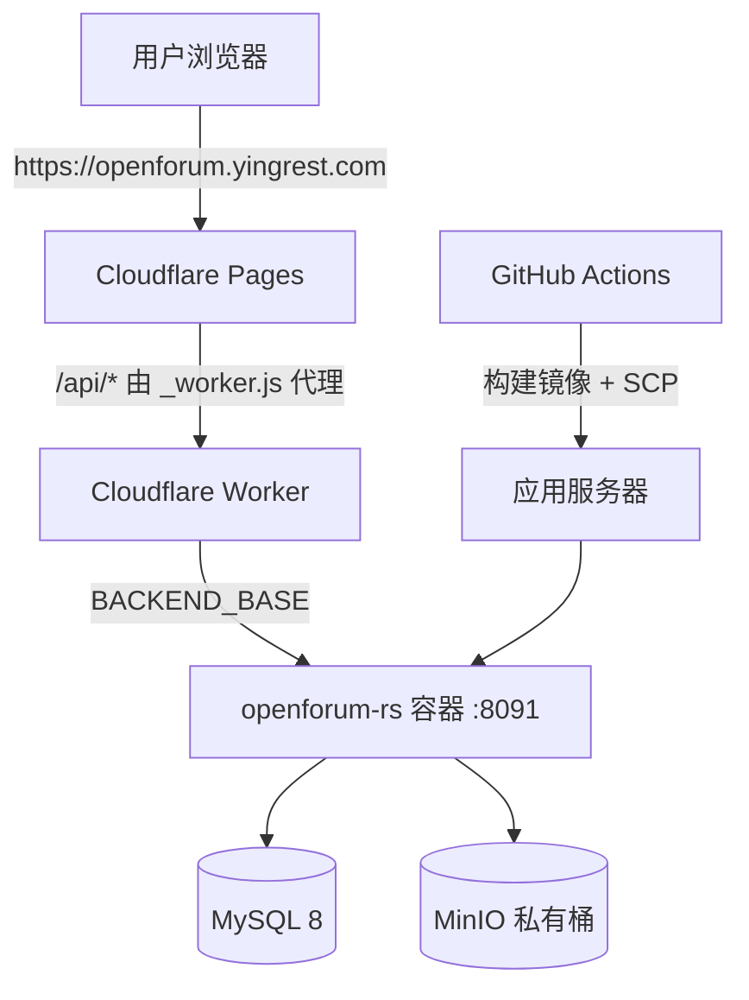

# 部署指南
[English](DEPLOYMENT.md) · **简体中文**

本文描述 OpenForum 的生产部署方式：前端托管在 Cloudflare Pages，后端以 Docker 容器运行，数据层使用 MySQL 8 与 MinIO。

## 1. 部署拓扑



| 组件 | 位置 | 端口 |
| --- | --- | --- |
| 前端静态资源 | Cloudflare Pages 项目 `openforum` | 443 |
| API 代理 | `frontend/public/_worker.js` | — |
| 后端容器 | 应用服务器 Docker | `8091:8080` |
| MySQL | 容器 / 托管实例 | 3306（内网） |
| MinIO | 容器 / 托管实例 | 9000（内网） |

## 2. 前置资源

1. Cloudflare 账号与已绑定域名的 Pages 项目。
2. 一台可 SSH 登录的 Linux 服务器，安装 Docker。
3. MySQL 8.0 数据库（库名 `openforum`，字符集 `utf8mb4`）。
4. MinIO（或任意 S3 兼容服务）与私有桶，例如 `openforum-auth`。
5. 仓库 Secrets：`SSH_PRIVATE_KEY`。

## 3. 前端部署（Cloudflare Pages）

### 3.1 构建参数

| 项目 | 值 |
| --- | --- |
| Root directory | `frontend` |
| Build command | `npm run build` |
| Output directory | `dist` |
| Node 版本 | 18+ |

构建环境变量：

| 变量 | 示例 | 说明 |
| --- | --- | --- |
| `VITE_BASE_PATH` | `/` | 独立域名部署用 `/`；子路径部署用 `/forum/` |
| `VITE_API_BASE_URL` | `/api` | 与 `_worker.js` 的代理路径一致 |
| `VITE_APP_NAME` | `OpenForum` | 站点标题 |
| `VITE_GOOGLE_CLIENT_ID` | `xxx.apps.googleusercontent.com` | 可选，留空隐藏 Google 登录 |

### 3.2 运行时变量

Pages 项目设置中的 `BACKEND_BASE` 供 Worker 使用，例如：

```text
BACKEND_BASE=https://backend.example.com
```

`_worker.js` 会把 `/api/*`、`/forum/api/*`、`/forum/rs/api/*` 统一改写为 `/api/*` 后转发到 `BACKEND_BASE`，并补齐 `/__health` 健康检查与 SPA 回退。

### 3.3 手动发布

```bash
cd frontend
npm ci
VITE_BASE_PATH=/ VITE_API_BASE_URL=/api VITE_APP_NAME=OpenForum npm run build
npx wrangler pages deploy dist --project-name openforum --branch main
```

发布后在 Pages 控制台绑定自定义域名并开启 HTTPS。

## 4. 后端部署

### 4.1 准备环境变量文件

在服务器上创建 `/root/openforum-build-rs/openforum-rs.env`，内容参考 [openforum-rs.env.example](../backend-rs/deploy/openforum-rs.env.example)：

```bash
SERVER_PORT=8080

DB_URL=jdbc:mysql://openforum-mysql:3306/openforum
DB_USER=openforum
DB_PASSWORD=<强密码>

JWT_SECRET=<至少 32 字节的随机值>
JWT_EXPIRATION_HOURS=168

MINIO_ENABLED=true
MINIO_ENDPOINT=http://minio:9000
MINIO_ACCESS_KEY=<access-key>
MINIO_SECRET_KEY=<secret-key>
MINIO_BUCKET=openforum-auth

AI_ENABLED=false
GOOGLE_CLIENT_ID=
```

注意事项：

- 环境文件包含密钥，权限设为 `600`，不要提交到仓库。
- `DB_URL` 中的主机名必须是容器网络内可解析的名称。
- 生产环境必须替换 `JWT_SECRET` 与数据库密码。

### 4.2 手动构建与启动

```bash
docker build -t openforum-rs:latest backend-rs

docker network create openforum-net 2>/dev/null || true

docker stop openforum-rs 2>/dev/null || true
docker rm openforum-rs 2>/dev/null || true

docker run -d --name openforum-rs \
  --network openforum-net \
  --restart unless-stopped \
  -p 8091:8080 \
  --memory 256m --memory-swap 384m \
  --env-file /root/openforum-build-rs/openforum-rs.env \
  openforum-rs:latest
```

容器启动后检查：

```bash
docker ps --filter name=openforum-rs
docker logs --tail 50 openforum-rs
curl -s http://127.0.0.1:8091/api/plugins | head
```

### 4.3 GitHub Actions 自动部署

[`deploy-rs.yml`](../.github/workflows/deploy-rs.yml) 在以下条件触发：

- 推送到 `main` 且改动包含 `backend-rs/**` 或该工作流文件；
- 手动 `workflow_dispatch`。

流程：`docker build` → `docker save | gzip` → `scp` 到服务器 → `docker load` → 重建容器 → 健康等待与日志输出。失败时任务会打印容器日志并以非零状态退出。

需要配置：

| 名称 | 类型 | 说明 |
| --- | --- | --- |
| `SSH_PRIVATE_KEY` | Repository secret | 部署私钥（支持 PEM 或 base64） |
| `production` | Environment | 可选，用于保护部署 |

服务器地址与端口写在 workflow 中，迁移服务器时需同步修改。

## 5. 反向代理

### 5.1 Cloudflare Worker（当前线上方式）

`_worker.js` 已处理：

- 同源代理，避免 CORS；
- 转发请求体（包括 multipart 上传）；
- 删除 `content-encoding` / `content-length`，避免压缩头不一致；
- 上游异常返回 `502 {"code":502,"message":"API upstream error"}`；
- 静态资源 404 且 `Accept: text/html` 时回退 `index.html`。

### 5.2 Nginx（备选）

```nginx
server {
    listen 443 ssl;
    server_name forum.example.com;

    root /var/www/openforum;
    index index.html;

    location /api/ {
        proxy_pass http://127.0.0.1:8091/api/;
        proxy_set_header Host $host;
        proxy_set_header X-Real-IP $remote_addr;
        proxy_set_header X-Forwarded-For $proxy_add_x_forwarded_for;
        proxy_set_header X-Forwarded-Proto $scheme;
        client_max_body_size 60m;
    }

    location /assets/ {
        expires 30d;
        add_header Cache-Control "public, immutable";
    }

    location / {
        try_files $uri $uri/ /index.html;
    }
}
```

> 上传接口最大 60MB，Nginx 的 `client_max_body_size` 必须不小于该值。

## 6. 数据库与存储

### 6.1 初始化数据库

```bash
mysql -h <host> -u root -p -e "CREATE DATABASE openforum CHARACTER SET utf8mb4 COLLATE utf8mb4_unicode_ci;"
mysql -h <host> -u root -p openforum < backend-rs/sql/schema.sql

# 建议使用独立账号而非 root
mysql -h <host> -u root -p -e "
CREATE USER 'openforum'@'%' IDENTIFIED BY '<强密码>';
GRANT SELECT, INSERT, UPDATE, DELETE, CREATE, ALTER, INDEX ON openforum.* TO 'openforum'@'%';
FLUSH PRIVILEGES;"
```

### 6.2 MinIO

```bash
mc alias set local http://127.0.0.1:9000 <access-key> <secret-key>
mc mb local/openforum-auth
mc anonymous set none local/openforum-auth   # 私有桶
```

桶保持私有；读取统一通过后端 `/api/media/:id` 与 `/api/authentications/media/:id`。

## 7. 发布后验证

```bash
# 1. 公开接口
curl -s https://openforum.yingrest.com/api/plugins

# 2. 登录
curl -s -X POST https://openforum.yingrest.com/api/auth/login \
  -H 'Content-Type: application/json' \
  -d '{"usernameOrEmail":"admin","password":"admin123"}'

# 3. OpenAPI 下发
curl -sI https://openforum.yingrest.com/api/developers/docs

# 4. 前端路由（SPA 回退）
curl -sI https://openforum.yingrest.com/developers/docs
```

预期：接口返回 `code=200`；`/developers/docs` 返回 `200` 与 YAML；任意前端路由返回 `200` 与 HTML。

## 8. 回滚

- **后端**：保留上一个镜像标签，重新 `docker run` 指定旧镜像即可；数据库结构变更需确认向后兼容。
- **前端**：Cloudflare Pages 控制台可回滚到任意历史部署。
- **数据库**：变更前执行 `mysqldump`，回滚时导入备份。

## 9. 上线检查清单

- [ ] `JWT_SECRET` ≥ 32 字节且为随机值
- [ ] 数据库使用独立账号与强密码
- [ ] `MINIO_ENABLED=true` 且桶为私有
- [ ] `GOOGLE_CLIENT_ID` 前后端一致（如启用）
- [ ] 前端 `VITE_API_BASE_URL` 与 Worker 代理路径一致
- [ ] 自定义域名已开启 HTTPS
- [ ] 默认账号密码已修改或删除
- [ ] 备份策略与日志采集已配置
- [ ] 服务器时区固定为 UTC
