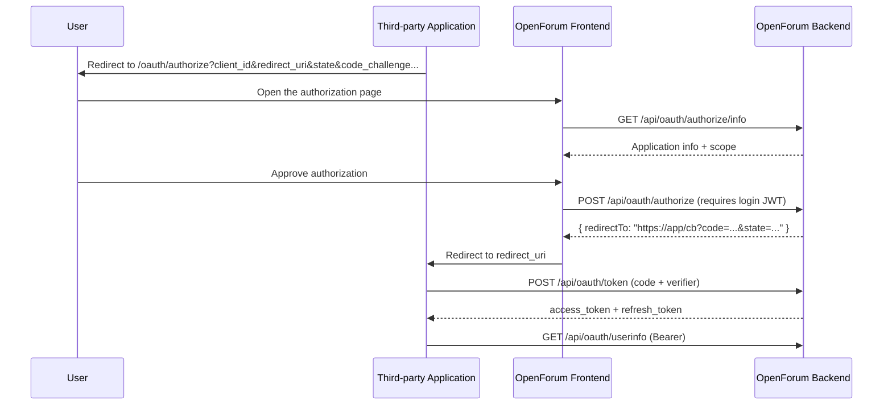

# OAuth 2.0 Integration Guide

[English](OAUTH.md) · [简体中文](OAUTH.zh-CN.md)

OpenForum ships with a built-in OAuth 2.0 authorization server, so third-party applications can call all public APIs on behalf of a user after that user grants authorization. The implementation follows RFC 6749 (authorization code grant), RFC 7636 (PKCE) and RFC 7009 (token revocation).

- Authorization endpoint: `https://openforum.yingrest.com/oauth/authorize` (frontend page)
- API base URL: `https://openforum.yingrest.com/api`
- Token type: `Bearer`
- Current scope: `api` (calls all public endpoints on behalf of the user)

## 1. Roles and Flow



## 2. Creating an Application

After signing in to OpenForum, go to `/developers`:

1. Click create application, then fill in the name, description and homepage.
2. Configure redirect URIs: HTTPS is required; for local development `http://localhost` and `http://127.0.0.1` are allowed. At most 5, and they must match exactly.
3. Choose the client type:

| Type | Use case | Secret | PKCE |
| --- | --- | --- | --- |
| `CONFIDENTIAL` | Server-side applications with a secure backend | Has `client_secret` | Optional (recommended) |
| `PUBLIC` | Browser SPAs, mobile apps, desktop apps | None | **Required** |

A `client_secret` is returned once when creation succeeds; the server stores only its SHA-256 hash, so **save it immediately**. If it is lost, it can only be reset on the application details page.

Quota: each user may have at most 10 applications, and each application may have at most 5 redirect URIs.

## 3. Step 1: Initiate Authorization

Redirect the user's browser to:

```text
https://openforum.yingrest.com/oauth/authorize
  ?client_id=ofc_xxxxxxxx
  &redirect_uri=https%3A%2F%2Fexample.com%2Fcallback
  &response_type=code
  &scope=api
  &state=<random value>
  &code_challenge=<PKCE challenge>
  &code_challenge_method=S256
```

| Parameter | Required | Description |
| --- | --- | --- |
| `client_id` | Yes | Assigned when the application is created |
| `redirect_uri` | Yes | Must be one of the registered redirect URIs of the application |
| `response_type` | Recommended | Fixed to `code` |
| `scope` | No | Defaults to `api`, and must be a subset of the scopes allowed for the application |
| `state` | Strongly recommended | Returned unchanged, used to prevent CSRF; length ≤ 512 |
| `code_challenge` | Required for PUBLIC | `BASE64URL(SHA256(code_verifier))`, without padding, length 43–128 |
| `code_challenge_method` | No | Only `S256` is supported (default) |

The authorization page asks the user to sign in and displays the application name, owner and scope. If the user clicks "Deny", the browser is redirected to:

```text
https://example.com/callback?error=access_denied&state=...
```

## 4. Step 2: Exchange the Authorization Code for a Token

```http
POST /api/oauth/token
Content-Type: application/x-www-form-urlencoded

grant_type=authorization_code
&code=ofac_xxxxxxxx
&redirect_uri=https%3A%2F%2Fexample.com%2Fcallback
&code_verifier=<the original 43-128 character verifier>
```

Client authentication takes one of two forms:

- HTTP Basic: `Authorization: Basic base64(client_id:client_secret)`
- Form fields: `client_id` + `client_secret`

PUBLIC clients only need to send `client_id` (no secret), but must send `code_verifier`.

Successful response (`Cache-Control: no-store`):

```json
{
  "access_token": "eyJhbGciOiJIUzI1NiIs...",
  "token_type": "Bearer",
  "expires_in": 7200,
  "refresh_token": "ofrt_xxxxxxxx",
  "scope": "api"
}
```

Constraints:

- The authorization code is valid for **5 minutes** and can be used only once.
- The authorization code is tightly bound to `redirect_uri` and `client_id`; if either does not match, the request fails.
- If `code_challenge` was sent during authorization, the matching `code_verifier` must be provided when exchanging for a token.

## 5. Refreshing Tokens

```http
POST /api/oauth/token
Content-Type: application/x-www-form-urlencoded

grant_type=refresh_token
&refresh_token=ofrt_xxxxxxxx
```

The response is the same as the initial exchange and **returns a new refresh_token**; the old one becomes invalid immediately (rotation). Refresh tokens are valid for 30 days.

## 6. Calling the API

```bash
curl https://openforum.yingrest.com/api/auth/me \
  -H "Authorization: Bearer <access_token>"
```

The access token is an HS256 JWT whose claims include:

| Claim | Description |
| --- | --- |
| `sub` | Authorizing user ID |
| `username` | Username |
| `role` | `USER` / `ADMIN` |
| `cid` | OAuth client ID |
| `scope` | Authorized scope |
| `typ` | `oauth` |
| `iat` / `exp` | Issued at / expiration time (2 hours) |

The token represents the user themselves, so permissions match those of the user signing in directly on the site (including administrator permissions). Protect the access token as you would a password.

## 7. User Information

```http
GET /api/oauth/userinfo
Authorization: Bearer <access_token>
```

```json
{
  "sub": "1",
  "preferred_username": "admin",
  "name": "admin",
  "picture": null,
  "role": "ADMIN"
}
```

This endpoint returns bare JSON and does not use the `{code,message,data}` envelope.

## 8. Revoking Tokens

```http
POST /api/oauth/revoke
Content-Type: application/x-www-form-urlencoded
Authorization: Basic base64(client_id:client_secret)

token=ofrt_xxxxxxxx
```

Returns `200` on success (empty response body). The current implementation revokes **refresh tokens**; access tokens are stateless JWTs and expire naturally after 2 hours.

## 9. Error Responses

OAuth endpoints use the RFC 6749 error format:

```json
{
  "error": "invalid_grant",
  "error_description": "Authorization code has expired"
}
```

| `error` | HTTP | Meaning |
| --- | --- | --- |
| `invalid_request` | 400 | A required parameter is missing or malformed |
| `invalid_client` | 401 | The client does not exist, is disabled, or the secret is wrong; the response includes `WWW-Authenticate` |
| `invalid_grant` | 400 | The authorization code / refresh token is invalid, expired, already used, or does not match |
| `unsupported_grant_type` | 400 | Unsupported `grant_type` |
| `server_error` | 500 | Server-side error |

Parameter errors at the authorization page stage (such as an unregistered redirect URI) are returned by the regular API as `400 {"code":400,"message":...}`.

## 10. Complete Examples

### 10.1 Server-side Application (CONFIDENTIAL)

```bash
# 1) After the user completes authorization in the browser, obtain the code
CODE=ofac_xxxxxxxx
REDIRECT=https://example.com/callback

# 2) Exchange for a token
curl -s -X POST https://openforum.yingrest.com/api/oauth/token \
  -u "$CLIENT_ID:$CLIENT_SECRET" \
  -H 'Content-Type: application/x-www-form-urlencoded' \
  -d "grant_type=authorization_code" \
  -d "code=$CODE" \
  -d "redirect_uri=$REDIRECT"

# 3) Call an endpoint
curl -s https://openforum.yingrest.com/api/auth/me \
  -H "Authorization: Bearer $ACCESS_TOKEN"
```

### 10.2 Browser Application (PUBLIC + PKCE)

```js
// Generate the verifier and challenge
const random = crypto.getRandomValues(new Uint8Array(32))
const verifier = base64url(random)                 // 43 characters
const digest = await crypto.subtle.digest('SHA-256', new TextEncoder().encode(verifier))
const challenge = base64url(new Uint8Array(digest))

sessionStorage.setItem('pkce_verifier', verifier)
sessionStorage.setItem('oauth_state', state)

location.href = `https://openforum.yingrest.com/oauth/authorize?` +
  new URLSearchParams({
    client_id: CLIENT_ID,
    redirect_uri: REDIRECT_URI,
    response_type: 'code',
    scope: 'api',
    state,
    code_challenge: challenge,
    code_challenge_method: 'S256',
  })

function base64url(bytes) {
  return btoa(String.fromCharCode(...bytes))
    .replace(/\+/g, '-').replace(/\//g, '_').replace(/=+$/, '')
}
```

After the callback page verifies `state`, call `/api/oauth/token` with `code` + `code_verifier` (no `client_secret` needed).

## 11. Security Checklist

- Use a new random `state` for every authorization request, and compare it strictly on callback.
- PUBLIC clients must use PKCE, and the `code_verifier` must be kept only in the current session.
- Redirect URIs are matched exactly; extra parameters or fragments (`#`) are not allowed.
- Do not store `access_token` / `refresh_token` long-term in URLs, logs, or frontend-readable storage.
- Keep `client_secret` only in server-side environment variables, and reset it in the developer center immediately if leaked.
- Tokens and authorization codes are stored server-side only as SHA-256 hashes.

## 12. Related Source Code

| File | Contents |
| --- | --- |
| [`backend-rs/src/routes/oauth.rs`](../backend-rs/src/routes/oauth.rs) | Authorization, token, userinfo, revocation |
| [`backend-rs/src/oauth.rs`](../backend-rs/src/oauth.rs) | Clients, PKCE, redirect URI validation, token generation |
| [`backend-rs/src/routes/developers.rs`](../backend-rs/src/routes/developers.rs) | Application CRUD and secret reset |
| [`frontend/src/views/OAuthAuthorize.vue`](../frontend/src/views/OAuthAuthorize.vue) | Authorization consent page |
| [`backend-rs/api/openapi.yaml`](../backend-rs/api/openapi.yaml) | Machine-readable specification |
