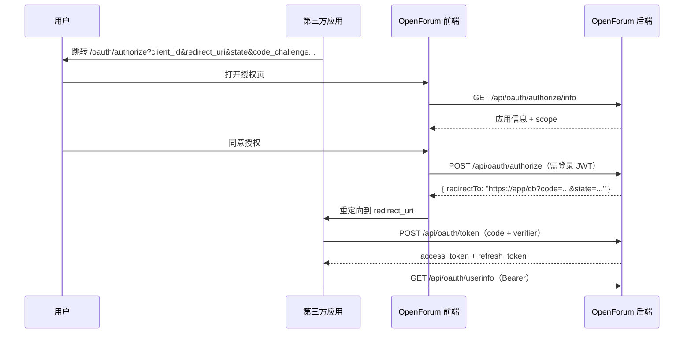

# OAuth 2.0 接入指南
[English](OAUTH.md) · **简体中文**

OpenForum 内置 OAuth 2.0 授权服务器，第三方应用可以在用户授权后代表其调用全部公开 API。实现遵循 RFC 6749（授权码模式）、RFC 7636（PKCE）与 RFC 7009（令牌撤销）。

- 授权端点：`https://openforum.yingrest.com/oauth/authorize`（前端页面）
- API 基地址：`https://openforum.yingrest.com/api`
- 令牌类型：`Bearer`
- 当前 scope：`api`（代表用户调用全部公开接口）

## 1. 角色与流程



## 2. 创建应用

登录 OpenForum 后进入 `/developers`：

1. 点击创建应用，填写名称、描述、主页。
2. 配置回调地址：必须是 HTTPS；本地开发允许 `http://localhost` 与 `http://127.0.0.1`。最多 5 个，需精确匹配。
3. 选择客户端类型：

| 类型 | 适用场景 | 密钥 | PKCE |
| --- | --- | --- | --- |
| `CONFIDENTIAL` | 有安全后端的服务端应用 | 有 `client_secret` | 可选（建议启用） |
| `PUBLIC` | 浏览器 SPA、移动端、桌面端 | 无 | **必须** |

创建成功后会返回一次 `client_secret`，服务端只保存其 SHA-256 哈希，**请立即保存**。遗失后只能在应用详情页重置。

配额：每个用户最多 10 个应用，每个应用最多 5 个回调地址。

## 3. 第一步：发起授权

把用户浏览器重定向到：

```text
https://openforum.yingrest.com/oauth/authorize
  ?client_id=ofc_xxxxxxxx
  &redirect_uri=https%3A%2F%2Fexample.com%2Fcallback
  &response_type=code
  &scope=api
  &state=<随机值>
  &code_challenge=<PKCE challenge>
  &code_challenge_method=S256
```

| 参数 | 必填 | 说明 |
| --- | --- | --- |
| `client_id` | 是 | 应用创建时分配 |
| `redirect_uri` | 是 | 必须在应用登记的回调地址中 |
| `response_type` | 建议 | 固定 `code` |
| `scope` | 否 | 默认 `api`，必须是应用允许的 scope 子集 |
| `state` | 强烈建议 | 原样回传，用于防 CSRF；长度 ≤ 512 |
| `code_challenge` | PUBLIC 必填 | `BASE64URL(SHA256(code_verifier))`，无 padding，长度 43–128 |
| `code_challenge_method` | 否 | 仅支持 `S256`（默认） |

授权页会要求用户登录并展示应用名称、所属者与 scope。用户点击「拒绝」时，浏览器会被重定向到：

```text
https://example.com/callback?error=access_denied&state=...
```

## 4. 第二步：用授权码换取令牌

```http
POST /api/oauth/token
Content-Type: application/x-www-form-urlencoded

grant_type=authorization_code
&code=ofac_xxxxxxxx
&redirect_uri=https%3A%2F%2Fexample.com%2Fcallback
&code_verifier=<43-128 字符的原始 verifier>
```

客户端认证二选一：

- HTTP Basic：`Authorization: Basic base64(client_id:client_secret)`
- 表单字段：`client_id` + `client_secret`

PUBLIC 客户端只需传 `client_id`（无密钥），但必须传 `code_verifier`。

成功响应（`Cache-Control: no-store`）：

```json
{
  "access_token": "eyJhbGciOiJIUzI1NiIs...",
  "token_type": "Bearer",
  "expires_in": 7200,
  "refresh_token": "ofrt_xxxxxxxx",
  "scope": "api"
}
```

约束：

- 授权码有效期 **5 分钟**，且只能使用一次。
- 授权码与 `redirect_uri`、`client_id` 强绑定，任一不匹配都会失败。
- 若授权时携带了 `code_challenge`，换令牌时必须提供匹配的 `code_verifier`。

## 5. 刷新令牌

```http
POST /api/oauth/token
Content-Type: application/x-www-form-urlencoded

grant_type=refresh_token
&refresh_token=ofrt_xxxxxxxx
```

响应与首次换取一致，并且会**返回新的 refresh_token**；旧的立即失效（轮换）。刷新令牌有效期 30 天。

## 6. 调用 API

```bash
curl https://openforum.yingrest.com/api/auth/me \
  -H "Authorization: Bearer <access_token>"
```

访问令牌是 HS256 JWT，claims 包含：

| Claim | 说明 |
| --- | --- |
| `sub` | 授权用户 ID |
| `username` | 用户名 |
| `role` | `USER` / `ADMIN` |
| `cid` | OAuth 客户端 ID |
| `scope` | 授权 scope |
| `typ` | `oauth` |
| `iat` / `exp` | 签发 / 过期时间（2 小时） |

令牌代表用户本人，因此权限与用户在站内直接登录时一致（包括管理员权限）。请像保护密码一样保护访问令牌。

## 7. 用户信息

```http
GET /api/oauth/userinfo
Authorization: Bearer <access_token>
```

```json
{
  "sub": "1",
  "preferred_username": "admin",
  "name": "admin",
  "picture": null,
  "role": "ADMIN"
}
```

该端点返回裸 JSON，不套用 `{code,message,data}` 信封。

## 8. 撤销令牌

```http
POST /api/oauth/revoke
Content-Type: application/x-www-form-urlencoded
Authorization: Basic base64(client_id:client_secret)

token=ofrt_xxxxxxxx
```

成功返回 `200`（空响应体）。当前实现撤销的是**刷新令牌**；访问令牌为无状态 JWT，会在 2 小时后自然过期。

## 9. 错误响应

OAuth 端点使用 RFC 6749 错误格式：

```json
{
  "error": "invalid_grant",
  "error_description": "Authorization code has expired"
}
```

| `error` | HTTP | 含义 |
| --- | --- | --- |
| `invalid_request` | 400 | 缺少必填参数或格式错误 |
| `invalid_client` | 401 | 客户端不存在、被禁用或密钥错误；响应含 `WWW-Authenticate` |
| `invalid_grant` | 400 | 授权码 / 刷新令牌无效、过期、已使用或不匹配 |
| `unsupported_grant_type` | 400 | 不支持的 `grant_type` |
| `server_error` | 500 | 服务端异常 |

授权页阶段的参数错误（如未登记的回调地址）由普通 API 返回 `400 {"code":400,"message":...}`。

## 10. 完整示例

### 10.1 服务端应用（CONFIDENTIAL）

```bash
# 1) 用户在浏览器完成授权后，拿到 code
CODE=ofac_xxxxxxxx
REDIRECT=https://example.com/callback

# 2) 换取令牌
curl -s -X POST https://openforum.yingrest.com/api/oauth/token \
  -u "$CLIENT_ID:$CLIENT_SECRET" \
  -H 'Content-Type: application/x-www-form-urlencoded' \
  -d "grant_type=authorization_code" \
  -d "code=$CODE" \
  -d "redirect_uri=$REDIRECT"

# 3) 调用接口
curl -s https://openforum.yingrest.com/api/auth/me \
  -H "Authorization: Bearer $ACCESS_TOKEN"
```

### 10.2 浏览器应用（PUBLIC + PKCE）

```js
// 生成 verifier 与 challenge
const random = crypto.getRandomValues(new Uint8Array(32))
const verifier = base64url(random)                 // 43 字符
const digest = await crypto.subtle.digest('SHA-256', new TextEncoder().encode(verifier))
const challenge = base64url(new Uint8Array(digest))

sessionStorage.setItem('pkce_verifier', verifier)
sessionStorage.setItem('oauth_state', state)

location.href = `https://openforum.yingrest.com/oauth/authorize?` +
  new URLSearchParams({
    client_id: CLIENT_ID,
    redirect_uri: REDIRECT_URI,
    response_type: 'code',
    scope: 'api',
    state,
    code_challenge: challenge,
    code_challenge_method: 'S256',
  })

function base64url(bytes) {
  return btoa(String.fromCharCode(...bytes))
    .replace(/\+/g, '-').replace(/\//g, '_').replace(/=+$/, '')
}
```

回调页校验 `state` 后，用 `code` + `code_verifier` 调用 `/api/oauth/token`（无需 `client_secret`）。

## 11. 安全检查清单

- 每次授权使用新的随机 `state`，并在回调时严格比对。
- PUBLIC 客户端必须使用 PKCE，且 `code_verifier` 只保存在当前会话。
- 回调地址精确匹配，不允许多余参数或片段（`#`）。
- 不要在 URL、日志或前端可读存储中长期保存 `access_token` / `refresh_token`。
- `client_secret` 只存放在服务端环境变量中，泄露后立即在开发者中心重置。
- 令牌与授权码在服务端仅以 SHA-256 哈希形式落库。

## 12. 相关源码

| 文件 | 内容 |
| --- | --- |
| [`backend-rs/src/routes/oauth.rs`](../backend-rs/src/routes/oauth.rs) | 授权、令牌、userinfo、撤销 |
| [`backend-rs/src/oauth.rs`](../backend-rs/src/oauth.rs) | 客户端、PKCE、重定向校验、令牌生成 |
| [`backend-rs/src/routes/developers.rs`](../backend-rs/src/routes/developers.rs) | 应用 CRUD 与密钥重置 |
| [`frontend/src/views/OAuthAuthorize.vue`](../frontend/src/views/OAuthAuthorize.vue) | 授权同意页 |
| [`backend-rs/api/openapi.yaml`](../backend-rs/api/openapi.yaml) | 机器可读规范 |
